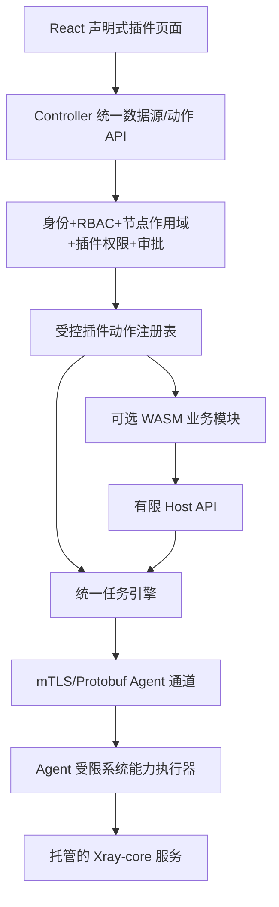

# Server Fleet v0.9 — G1 架构与技术栈评审报告

> 状态：**评审建议 / 待项目所有者批准**。编写依据为 `v0.9/docs-r2` 现行 PRD、G1 登记表、已有已批准 ADR（2026-10-26）与 Xray 插件规范。**本文件不自动替换任何 Accepted ADR，不修改现行 OpenAPI，也不意味着功能已实现。**
>
> 范围：解决已批准产品功能与旧技术决策的冲突；确认技术栈是否仍适合轻量多节点群控；给出 G2 契约冻结先决条件。

## 1. 执行摘要

**建议保留整体架构**：单主控、轻量 Linux Agent、浏览器管理台、统一任务调度/审批/审计/节点授权。当前架构目标是在不引入 Redis/Kafka/Kubernetes 或额外常驻服务的前提下，管理最初约 10–30 台、多地域低配 VPS，验证规模逐步覆盖 100 台。

**四个 G1 结论**：
1. Go + React/TypeScript/Vite + shadcn/ui + SQLite WAL + mTLS/Protobuf + SSE **继续保留**，分别通过端到端及低配压力测试；不在 G1 阶段重选技术栈。
2. `ADR-PLUGIN-001` 的“编译期内置可选插件后端”**与已批准的按需安装矛盾**，需要正式修订。首选**声明式 UI + 受控 WASM 逻辑 + 有限主控/Agent 能力**，但在安全与性能 PoC 通过前不得将 WASM 宣布为最终锁定方案。
3. `ADR-DEPLOY-001` 的“只接管已有 Nginx”与已批准“一键新建网关”矛盾，应扩充为 **安全接管已存在实例**与**管理员批准的全新安装**两条独立路径，准入调度必须在健康检查且管理员启用之后。
4. AI 的「完全访问」只是**审批便利模式**，不放大 RBAC 与会话授权范围，不解除对任意 root Shell、根密钥、凭据导出等硬性安全限制；解释性补充须写入 ADR 与接口验收。

**G1 状态：本报告完成评审建议，尚未取得项目所有者对修订 ADR 的批准，不能标记 G1 通过。**

## 2. 技术栈逐项检查

| 领域 | 当前方案 | G1 建议 | 原因及限制 |
|---|---|---|---|
| 主控 | Go 模块化单体、单控制平面 | **保留** | 单二进制、部署简单；按领域分包，避免把所有能力放一个大文件 |
| Agent | Go、Linux amd64/arm64、单常驻进程 | **保留，强制降权/最小操作能力** | 一键安装，主动连接；既有 root Agent 决策保留，但具体写操作必须限权、审计 |
| 前端 | React + TypeScript + Vite + shadcn/ui | **保留** | 声明式页面渲染器兼容；正式构建静态资源；不要求 Node.js 常驻 |
| 数据库 | SQLite WAL | **保留并有条件验收** | 适合单主控中小规模；单写者与长事务、WAL 增长是必须测试的边界；禁止网络共享文件系统上直接运行 WAL |
| Agent 通信 | Agent 主动出站 mTLS + 长连接、Protobuf | **保留** | 不要求被控端开放管理端口；需要协商版本、续连、执行幂等、流控和证书吊销 |
| 管理 API | REST/OpenAPI 3.1 | **保留** | 与前端和多 Agent 分工契合；G2 补全认证/RBAC/审计/异步事件与统一错误模型 |
| 前端事件流 | SSE | **保留** | 任务与监控状态单向推送；文件大流量不可强塞 SSE |
| 任务调度 | 内置有界队列 + SQLite 持久作业 | **保留** | 全部 Web/AI/插件共享；沿用 1→5 批次、15 分钟离线 TTL 与持久执行 ID |
| DNS | 主控原生 Cloudflare 适配，供应商可扩展 | **保留** | 第一版只实现 Cloudflare；不额外安装 DNS 插件 |
| 证书 | 公网 ACME 与内部私有 PKI 分离 | **保留** | 离线 Root CA，节点本地私钥，不将网站与 REALITY 私钥错误混同 |
| AI | 主控内受控 AI 工具层、可关闭的 BYOK 模型 | **保留策略，不提前锁定具体 ADK** | Eino 先做 PoC，不通过再评估替代；工具调用独立于模型强制授权 |
| 插件 | 旧 ADR：编译进主控 | **修订** | 新需求明确可选插件不打进 Release，GitHub 按需安装、可热卸载与更新 |
| 网关 | 旧 ADR：只管理已安装 Nginx | **修订** | 允许选择在线节点新安装 Nginx；必须不破坏已有服务与配置 |

### 2.1 为什么不立刻替换 SQLite？

计划规模下，SQLite 仍是较低复杂度的起点，但不能承诺“100 台一定可用”。需分别测：100 台 Agent 每分钟指标写入、任务日志突发写入、证书/告警写入以及备份快照期间的尾延迟、内存与 WAL 增长；设置保留期、批量写入、checkpoint 与磁盘上限。若实测出现不可接受的持久写争用，再依据结果评审替代方案，而非先引入 PostgreSQL 作为强制依赖。

## 3. 插件运行与分发：G1 决策重点

### 3.1 备选方案比较

| 方案 | 按需热安装 | 独立运行/故障隔离 | 轻量性 | 安全难点 | 评审结论 |
|---|---|---|---|---|---|
| A. 编译期内置 Go 业务插件 | 不满足（安装后端需重编） | 与主控同进程 | 空载包体变大 | 可信代码过大、违反新要求 | **淘汰为第一版可选插件模型** |
| B. 纯 JSON/YAML 声明式插件 | 支持 UI/操作注册 | 没有自定义执行逻辑 | 最轻 | 特定业务逻辑必须预置在核心 | **优先使用，复杂插件不足** |
| C. 声明式 UI + WASM 逻辑 + 主控受控能力接口 | 可支持，主控免重启 | 内存层隔离但仍同主控进程 | 较轻，需实测 | Host Function、内存/CPU 预算、逻辑与平台交互边界 | **首选 PoC** |
| D. 声明式 UI + 独立受限进程/RPC | 可支持 | OS 级资源/进程边界较强 | 占用与运维成本高一些 | 隔离用户、系统调用、RPC 认证 | **PoC 失败时的备选** |
| E. Go `plugin` 动态库 | 不能可靠热卸载，构建兼容严格 | 主控进程内 | 看似简单但依赖脆弱 | 工具链/编译标记匹配、崩溃风险 | **不采用** |

注意：WASM 内存隔离不是“插件绝不影响主控”的保证。Host Function 仍是主控的真实能力；若宿主端实现错误或放宽能力范围，插件可能影响系统。**不授予文件系统、网络、环境变量或进程执行的默认能力**；所有动作通过类型化、可审计的 Host API，并限制运行时间、内存、事件订阅与调用频率。

### 3.2 建议的实际结构

- `Plugin/` 是**源代码仓库中的可选插件目录**；正式发布包不预装 Xray 插件代码。
- 主控核心内置**插件管理器、通用 Schema 渲染能力、受控动作与任务接口**；插件下载包只包含清单、UI Schema、可选 WASM 模块、必要静态元数据，不允许热注入浏览器 JS。
- 正式安装文件进入**主控数据目录**，不能将运行文件直接写回 Git 工作树；GitHub Fork 是来源机制，不是信任证明。
- 安装时锁定 commit / 发布版本、校验完整性与可信来源，管理员确认敏感权限。对于自行 Fork，显示明确的“非官方来源”告警；不得假称 hash 校验等于作者可信。需在 G2 定义签名信任链与回滚策略。
- 仅 Xray 插件被批准；自定义通用插件能力将来可开放，但不代表第一版已批准任意来源插件的所有系统权限。

### 3.3 Xray 插件必须解决的能力边界

Xray 的安装/更新、写配置、启动服务、查询本机 gRPC 统计是**节点本地特权运维操作**，不能通过向 WASM 直接暴露任意 SSH、Shell、主控数据库或 Agent 连接来实现。

建议：控制端插件负责模板、校验、部署计划和呈现；Agent 执行经过主控授权的**受限类型化动作**（如 `managed-package.install`、`managed-config.validate-and-apply`、`managed-service.control`、`managed-stats.read`）。Xray 本地管理 API 仅回环/Unix socket，限定进程和端口，默认不开公网。所有具有修改副作用的执行仍走统一 Job 与审批。

**存在待验证难点**：是否能用数量足够少且通用的受限 Agent 动作完成 Xray 的用户增删、配置回滚、StatsService 采样而不演变为“任意 root 命令执行”。G1 必须做三类 PoC：模板生成/测试、配置灰度部署、流量计数读取与重置处理。若不能安全抽象，不得为了功能完成而解除插件权限边界。

### 3.4 热更新语义

允许在主控不重启时安装/启用/禁用/卸载和**有条件**更新插件；热更新需分阶段：下载与校验 → 兼容检查 → 暂停新任务 → 等待/取消在途任务 → 切换新版本 → 健康检查 → 失败恢复旧版本。无法安全中断的操作应延期，不能保证无停顿或正在执行的业务作业“原子迁移”。**禁用插件不等于自动卸载节点 Xray 服务。**

## 4. 网关自动安装：补充已批准 ADR

保留原有网关受管 Nginx 的全部安全要求，并增加两种显式管理路径：

1. **安全接管**：节点已安装 Nginx → 发现原有实例与站点 → 管理员确认托管目录/范围 → 测试配置 → 标记可管理；**不覆盖第三方站点**。
2. **新建安装**：管理员在在线节点选择“安装 Nginx” → 检查 OS/架构/磁盘空间、包管理器、端口、已存在安装与网络依赖 → 展示受影响项、需要的系统权限 → 通过已审核安装来源安装 → 验证 Nginx 服务、`nginx -t`、托管目录、后端健康 → 管理员确认启用调度。

**状态明确分离**：`未发现` / `预检查失败` / `安装中` / `已安装待验证` / `已验证待启用` / `维护中` / `可调度` / `失败待处理`。一次安装成功 **不直接等于** 已经加入生产调度。

未通过预检查时禁止写入；已有软件安装则转入接管流程；安装失败先安全清理本次创建的资源，不删除未知历史配置。服务器可以同时作为网关与业务节点，但网关选择不能绕过服务组调度、Nginx 端口冲突、TLS 私钥归属等限制。

主控只承载**控制平面**，真实访问流量仍走入口 Nginx → 业务后端。对于开源 Nginx，不假定它具备商业版本自动主动摘流功能。

## 5. AI 运维授权与审批：建议的解释性补充

**工具允许执行 = 用户自身 RBAC ∩ 当前会话已分配的节点/服务组有效成员 ∩ 工具操作权限 ∩ 插件权限 ∩ 组织硬性策略 ∩ 当前审批结果。**

- 新会话默认零资源授权、默认「每次审批」。
- 「自动审批」只自动放行服务端明确标记的低风险操作；风险分类不能由模型自己声明。
- 「完全访问」需要显式风险确认、短期到期（15/30/60 分钟），只减少**可豁免动作**的逐项确认，不会自动获得其他节点、凭据、服务组、插件权限。
- **任何 AI 发起的任意 root Shell** 仍然需有权限的管理员在真实 Web UI 审批；离线 Root CA 私钥、恢复私钥、Cloudflare/SMTP/QQ 原始密钥默认**没有对模型暴露的工具**。
- 服务组授权采用旧成员快照 ∩ 当前有效成员；组新增节点不会扩大旧授权，移除成员要立即撤销相关权限。
- 所有插件/子 Agent/异步任务/GitHub 插件内容必须经过同一个服务端能力网关，不得经直接网络连接或预存凭据横向越权。
- 节点 root Shell 可能通过已有凭据访问别的机器，因此严格隔离的安全承诺还需要进程凭据和横向网络访问的额外约束；不能只校验请求 Node ID。

## 6. 其他既有 ADR 的保持与衔接

| 旧决策 | G1 结论 |
|---|---|
| ADR-BOOT-001 | 保留 10 分钟单用注册令牌、可信安装器验签、固定 Root CA 指纹、节点身份轮换与吊销 |
| ADR-PRIV-001 | 保留 root 常驻 Agent + 普通子进程真实降权；插件受控动作禁止直接升级为任意未审批 root Shell |
| ADR-TASK-001 | 保留普通最多 5 台并发、修改/root 类默认 1→5、离线任务 15 分钟过期、执行 ID 去重、结果未知不盲目重试 |
| ADR-WC-001 | 公网入口独立 TLS 私钥；内部 mTLS 信任包可共享公开 CA 证书但不得共享节点身份私钥；Xray REALITY 私钥独立于网站证书 |
| ADR-PKI-OPS-001 | 保留每日加密备份、7 日+4 周、SFTP 异地、离线恢复私钥、隔离恢复和季度演练 |
| ADR-UPDATE-001 | 保留可信安装包签名/摘要、手动确认、Agent 身份独立以及更新失败尽力回退 |
| ADR-AI-001 | 保留内嵌可关闭 AI、BYOK、工具权限；具体框架 Eino PoC 尚未完成，不应直接冻结 |

## 7. G1 需要的可重复 PoC 与验收门槛

| 验证 ID | 实验 | 必须通过的条件 | 失败后处理 |
|---|---|---|---|
| POC-01 插件热生命周期 | 单主控启用/禁用/升级/回退一个受限 WASM 测试模块 | 不重启主控；禁用后 API 真正拒绝；旧任务不会使用失效权限；失败回退 | 评估独立受限进程模式 |
| POC-02 WASM 资源预算 | 1C1G 主控模拟插件空闲、执行和异常循环 | 测量 RSS/CPU/文件句柄/执行超时；插件异常不能绕过授权 | 修改内存/超时限制或切换隔离模式 |
| POC-03 Xray 配置 | Debian/Ubuntu、amd64/arm64 各代表环境 | 两种 VLESS 模板与自定义配置在受支持版本经配置测试成功；失败可保留旧配置 | 缩小受支持版本/平台，不放弃安全检查 |
| POC-04 Xray 统计 | 用户/入站/节点统计+重启+网络断连 | 字节量方向正确、重置与缺口可识别、不会与主机配额混为一谈 | 修正统计模型与采集职责 |
| POC-05 Nginx 网关 | 无 Nginx、已有 Nginx、端口占用、半安装失败 | 既有站点不被破坏；未健康/未授权不能调度；失败能诊断 | 修订安装与接管边界 |
| POC-06 AI 负向权限 | 零授权/越界节点/伪造完全访问/离线计划/AI root Shell | 所有越界路径均被后端拒绝，审计显示真正原因 | 不进入 G2 安全契约冻结 |
| POC-07 轻量与持久化 | 单主控 + 10/30/100 个模拟 Agent，长期指标与任务日志 | 记录峰值/空闲 RSS、CPU、网络、SQLite WAL 与 P95 延迟；不出现无限增长 | 调整保留/批处理，必要时重新评估 SQLite |
| POC-08 主控恢复 | 备份、故障、隔离恢复、旧主控回来 | 不能复活吊销节点/过期任务；旧主控必须确认隔离；证书与数据可恢复 | 先完善 PKI/备份边界 |

**建议的初始性能目标（不是现有成绩）**：Agent 典型 1C1G Linux VPS 空闲 RSS 争取 ≤40 MiB，空闲 CPU 长期平均低于 1%，监控周期默认 30–60 秒；主控须在 10/30/100 节点样本中评估是否可继续用 1C1G。目标最终由 PoC 测量和产品所有者确认，不宜只用理论值验收。

## 8. G2 契约冻结之前必须确认的接口边界

1. 唯一任务资源名与路径：从现有 `/tasks`、`/jobs` 取舍一套正式路径，避免平行执行引擎。
2. 控制台：登录/角色/资源授权/审计/流式事件/错误与重试/幂等状态模型。
3. Agent 协议：独立 Protobuf 定义身份、注册、心跳、任务、执行去重、能力协商、异常恢复和大文件传输。
4. 插件：`manifest`、可信来源、版本锁、UI Schema、host capability registry、状态转移、权限及错误码。
5. 网关：已有 Nginx 接管与新安装两个不同计划类型、安装后检查与启用调度的分离状态。
6. Xray：模板版本标识、敏感字段引用、用户与计数器关系、异步部署任务引用；不能直连主控私密数据。
7. 全部操作的统一语义：预检查、计划摘要、审批、权限撤销、冻结节点、任务阶段、失败恢复、审计链。

**G1 输出不等于 G2 已完成。** API/Protobuf 仍须单独冻结和兼容测试。

## 9. 决议请求与当前状态

| 决策 | 推荐 | 状态 |
|---|---|---|
| G1-D1 总体架构 | 保留 Go 模块化单体、轻量 Agent、React、SQLite、mTLS/Protobuf、SSE | 待批准 |
| G1-D2 插件运行 | 声明式 UI + 受限 WASM 作为 PoC 首选，PoC 失败评估受限进程/RPC；不采用 Go 原生 plugin | 待批准 |
| G1-D3 网关 | 两条操作路径（安全接管 / 新安装）+ 检查与调度准入分离 | 待批准 |
| G1-D4 AI 权限 | 完全访问不扩大资源或解除 AI root Shell 强制人工确认 | 待批准（解释性确认） |
| G1-D5 保留旧安全 ADR | BOOT/TASK/PRIV/WC/PKI/UPDATE 的非冲突要求继续生效 | 待批准（保持性确认） |
| G1-D6 工程验收 | 先做插件/Xray/网关/AI 安全 PoC 与轻量压测，再宣告 G1 技术方案冻结；G2 单独评审 | 待批准 |

若项目所有者批准本报告建议，应将第二份《ADR 修订提案》改为正式 ADR，明确取代旧条款，不可静默覆盖历史；经 PoC 证据确认运行模式之后再把技术选择写成无条件已锁定。

## 10. 官方技术资料（评审时核对）

- Go 原生 Plugin 的兼容性与热卸载限制：https://pkg.go.dev/plugin
- wazero 运行时架构、模块与宿主 API：https://wazero.io/docs/ ; https://github.com/wazero/wazero
- SQLite WAL 读写并发与 checkpoint：https://www.sqlite.org/wal.html
- Nginx 测试与重载：https://nginx.org/en/docs/switches.html
- Nginx 包仓库：https://nginx.org/en/linux_packages.html
- Vite 生产静态构建：https://vite.dev/guide/build
- Xray 原生统计字段：https://xtls.github.io/en/config/stats.html
