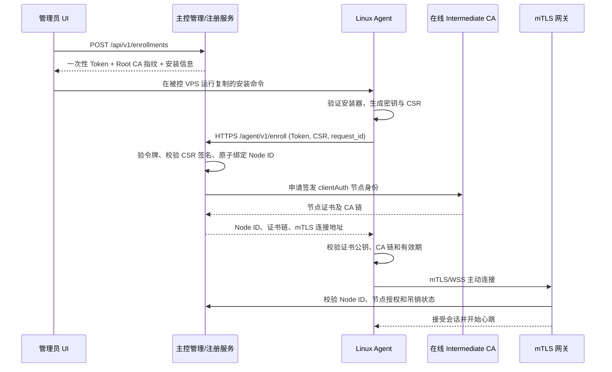

# ADR-BOOT-001：Agent 一键安装、安全注册与身份恢复

> **项目**：轻量级 AI 服务器群控平台（Server Fleet）  
> **文档类型**：架构决策记录（Architecture Decision Record）  
> **状态**：**已批准 / Accepted**（决策 BOOT-D1～D6 已冻结；具体 API 字段与签名封装仍为草案）  
> **版本**：v1.0 决策版（随项目文档 v0.4 发布）  
> **日期**：2026-10-26  
> **关联文档**：`01-PRD-需求文档-v0.5.md`、`02-技术架构方案-v0.5.md`、`03-API与通信协议-v0.5.md`；已批准的 `ADR-WC-001`  
> **边界**：本 ADR 的六项架构决策已获项目所有者批准，并同步进入 v0.4 总文档；OpenAPI / Protobuf 的具体字段及实现细节仍需单独审查。

## 0. 执行摘要

**已批准方案**：保留“主控添加服务器 → 复制一条命令 → 在 VPS 运行 → Agent 自动上线”的体验；安装阶段使用公开可信 HTTPS 与安装包完整性验证，注册阶段使用一次性高熵令牌、管理员界面提供的 **离线 Root CA SPKI SHA-256 指纹**建立独立信任，Agent 本地生成身份私钥和 CSR，主控由在线 Intermediate CA 签发短期节点证书，随后使用 **Agent 主动连接主控的 mTLS/WSS** 持续通信。主控签发证书前，必须原子绑定令牌、密钥和唯一 Node ID。

安全权衡：把注册令牌直接嵌入“一键复制命令”确实会增加 Shell 历史、进程参数、复制记录和终端录屏泄露风险。批准 **保留一键自动模式**，但同时提供不把秘密写在命令行的**安全交互模式**；对高安全要求可启用“管理员二次批准”。不要宣传“一键自动模式完全不泄露凭据”。

## 1. 本 ADR 适用的已批准上游约束

1. 主控采用**离线 Root CA + 在线 Intermediate CA**；在线主控不持有 Root CA 私钥。
2. Agent 从被控服务器**主动连接主控**，正式通信为 **mTLS**；被控服务器不需要新增公开监听端口。
3. 管理后台、初始注册入口使用公开可信 HTTPS；对外 HTTPS 由内置 ACME 管理，可由 Cloudflare 原生模块协助 DNS-01。
4. Agent 的身份私钥**仅在节点本地生成和保管**；不经由主控生成或下发。
5. Web、AI、插件、任务引擎统一使用授权与审计机制；不得绕过证书身份检查。
6. Agent 身份密钥与网站 TLS 私钥是**不同密钥**，两者绝不可混用。

## 2. 需求与非目标

### 2.1 功能需求

| 编号 | 要求 | 优先级 |
|---|---|---|
| BOOT-001 | Web“添加服务器”提供可复制的 Linux 安装命令 | P0 |
| BOOT-002 | 自动识别系统架构，安装适合的、可验证的 Agent 发布包 | P0 |
| BOOT-003 | 自动生成短时一次性节点注册令牌 | P0 |
| BOOT-004 | 首次注册前独立校验预期私有 Root CA 身份 | P0 |
| BOOT-005 | Agent 本地生成私钥/CSR，服务器审核并签发独立节点证书 | P0 |
| BOOT-006 | Agent 主动建立 mTLS/WSS，自动心跳、上线并回报基础系统信息 | P0 |
| BOOT-007 | 注册具备原子性、幂等重试、重放防护、限流与审计 | P0 |
| BOOT-008 | 支持撤销节点、证书轮换、Agent 更新及安全重装 | P0/P1 |
| BOOT-009 | 恢复主控、域名迁移时尽量保持已注册 Agent 的身份连续性 | P0（设计）/ P1（演练） |
| BOOT-010 | 安全交互安装模式及可选人工审核 | 交互模式 P0；人工审核 P1（首个完整版本） |

### 2.2 非目标

- 不实现无需可信管理界面、无需令牌或无需其他外部信任锚的“零信任凭空注册”。
- 不允许 Agent 仅凭“连接成功 / 已知 IP / 主机名”被视为授权节点。
- 不把主控私有 CA 安装进被控 Linux 全局 CA 信任列表。
- 不通过跳过证书验证（`InsecureSkipVerify`/`curl -k`）解决证书错误。
- 不保证宿主机已被 root 入侵、整机快照被复制时仍能保护纯软件密钥；硬件绑定身份为将来可选项。

## 3. 威胁模型与安全边界

| 威胁/故障 | 可能后果 | 防护措施 | 残余风险 |
|---|---|---|---|
| 公网链路中间人攻击 | 伪造主控或篡改安装包 | 公开 HTTPS + Root CA 指纹核对 + 发布包校验 | 初始管理 UI 或管理员终端被控制时依然危险 |
| 注册令牌泄露 | 攻击者抢注、消耗令牌 | 10 分钟、256 位随机、单用、权限范围限制、限流和可撤销 | 令牌未失效时仍可能被抢用；审批模式降低风险 |
| 伪造 Agent 身份 | 下发或窃取任务 | 客户端证书链 + EKU + Node ID SAN + 数据库状态检查 | VPS 密钥被盗后可被冒用直到封禁/吊销 |
| 网络超时导致重复注册 | 同一令牌注册出两个节点 | 数据库原子绑定 + 相同密钥 CSR 的受限幂等重试 | 恢复逻辑需严格实现和测试 |
| 安装脚本被替换 | 远程代码执行 | 静态校验和/发布签名、固定版本、权限收紧 | 若下载与校验所依据的信任数据同时被篡改则失守 |
| VPS 被重装/快照克隆 | 旧凭据失效或节点身份冲突 | 管理员授权替换、吊销旧密钥、重复会话检测 | 没有硬件证明时不能可靠识别克隆实体 |
| 主控迁移、域名/IP 变更 | Agent 集体离线 | 稳定通信域名 + 同一根 CA + 加密备份 + 重连退避 | 根 CA、身份数据库同时丢失需人工重建信任 |
| 中间 CA 被盗 | 冒签节点凭据 | Root CA 离线 + 受控签发 + 快速轮换/阻断 | 在线签发私钥为重大高价值目标 |

**信任边界**：管理员浏览器/会话 → 主控管理 API → 一次性注册端点 → Agent 本地密钥存储 → Agent mTLS 连接 → 主控授权与任务引擎。每一道边界独立验证，不能用上游“已经登录/已经连上”的状态替代下游授权。

## 4. 首次信任：要解决“先有鸡还是先有蛋”

### 4.1 两条不同的信任链

**链 A：安装与注册入口的公开 HTTPS**

- 管理员通过已经配置好公开可信证书的 `https://panel.example.com` 登录并创建注册请求。
- 安装器通过**标准公开 CA 校验**连接 `https://panel.example.com`，严禁忽略 HTTPS 错误。
- 公开 HTTPS 用于可信地获取安装内容与首次交互；它不替代未来的私有节点信任链。

**链 B：Agent 正式连接的私有 PKI**

- 管理页面通过管理员已认证的会话，将离线 **Root CA 公钥 SPKI 的 SHA-256 指纹**包含在安装信息内。
- Agent 接收主控提供的 Root CA 证书时，重新计算其 SPKI 指纹并进行常量时间比较；**只在匹配后**加入 Agent 专属信任库。
- 随后验证正式通信服务器证书是否能建立到该 Root CA 的完整有效链、匹配连接域名、具备 `serverAuth` 用途且处于有效期；单独匹配“某个指纹”不能代替链与主机名校验。
- Root CA 指纹与注册令牌必须由同一次经过认证的管理操作绑定，不接受注册过程中无条件下发的新 Root CA。

**重要限制**：如果安装命令来自被攻陷的管理页面，攻击者可以同时替换 URL、注册令牌和 CA 指纹。可选支持在独立可信设备核对根 CA 指纹；系统不能保证被攻陷管理员环境下的首次信任。

### 4.2 主控的首次初始化前提

若主控首次安装时还没有公网可信证书，管理员须先通过 `localhost`/SSH 隧道完成初始化、导入离线签发的 Intermediate CA、配置公网可信 HTTPS，然后才开启公网注册入口。**不能为方便注册临时开放明文 HTTP 管理端**。

## 5. 注册令牌与“复制一条命令”的权衡

### 5.1 令牌规格（已批准的 P0 约束）

- `crypto/rand` 产生至少 **256 位高熵**随机值；编码为 URL-safe Base64。
- 服务端仅保存令牌摘要（建议 HMAC-SHA256，服务端独立密钥），不保存明文；明文只在创建响应显示一次。
- 有效期**默认 10 分钟**，最大使用次数 1，绑定 enrollment ID、预期控制端及允许的注册用途。
- 注册令牌**仅允许申请一张指定节点身份**，不可用于运行命令、读取其他节点或调用管理 API。
- 注册创建、撤销、尝试、失效、成功、拒绝都产生日志，但禁止在日志/错误/Telemetry 中写令牌原文。
- 按 IP、enrollment ID 和全局维度限速；恶意来源防护不应误伤 NAT 下的正常部署。
- 不依赖被控公网 IP、GeoIP、hostname 或 OS 信息作为身份认证条件，它们最多是辅助审计线索。

### 5.2 已批准的两种 UI 模式

| 模式 | 操作体验 | 安全性与适用性 |
|---|---|---|
| **快速一键（用户原构想）** | 复制含一次性令牌的整条命令，在 VPS 执行后自动注册上线 | 默认 10 分钟、单次使用、敏感提示；令牌**可能**进入 Shell 历史、进程参数、剪贴板/终端日志，不能认为完全保密 |
| **安全交互** | 复制不含令牌的安装命令；Agent 安装器再通过不可回显的交互提示或受限文件/标准输入读取令牌 | 不在命令历史或命令参数中直接出现令牌；更适合多人管理与高敏感节点 |

正式决策：将“复制一次就全部自动完成”作为**默认快速模式**保留，但必须展示令牌敏感警告。可选 “高安全注册：Agent 发起申请后，管理员对 CSR 公钥指纹进行人工批准”；这多一次确认，不应伪称零交互。

### 5.3 安装命令：**逻辑示例，不是可执行的正式下载地址**

```bash
# 仅展示命令结构；实际 UI 会生成独立的令牌、Root CA 指纹和经验证的安装器摘要。
# install 脚本先安全下载，再严格校验版本/签名/摘要，之后才以所需权限执行。
sudo fleet-installer enroll \
  --control https://panel.example.com \
  --agent-endpoint agent.example.com \
  --enrollment-token '<ONE_TIME_TOKEN>' \
  --root-ca-spki-sha256 '<PIN_SHA256>'
```

完整产品的一键命令会包含 **HTTPS 下载固定版本的引导安装器 → 按已验证且由可信管理页面提供的摘要/签名信任锚验证引导安装器 → 执行安装器 → 校验 Agent 发布包摘要和数字签名** 的步骤；该示例刻意未提供未验证的 `curl | sudo sh` 指令。令牌进入命令行的风险依然存在，不能靠“短时间过期”彻底消除。

**安全交互模式**使用相同安装器，但由其直接从终端以不回显方式读取 Token，不把 Token 传为程序启动参数、环境变量或长期配置文件。安装成功后销毁临时令牌材料，清理临时目录。

### 5.4 安装物验证要求（BOOT-D6 强制）

- 可复现或可审计的发布流程，生产发布包**固定版本号和不可变摘要**；禁止静默下载 `latest` 后直接执行。
- 由管理员已认证的 UI 展示可信 SHA-256；发布包必须同时经过 SHA-256 摘要校验和可信发布密钥的数字签名验证（首版建议 Ed25519；公钥或可信指纹通过认证管理页面/可信安装材料固定），任何一步失败立即拒绝执行。
- 确认 Linux `amd64`/`arm64` 架构、安装前磁盘空间和运行权限；不支持的系统拒绝安装。
- 受保护的临时目录（0700）、严格失败即停、安装原子替换、systemd 自动启动、失败时清理或回滚。
- 安装器不能为了方便而写入 `curl -k`、`--insecure` 或临时禁用防火墙。
- 可供高级用户审阅安装脚本/签名/发行说明。

## 6. 完整注册状态机

建议状态：`created → installing → key_generated → requested → bound → issued → connected`；其他终态：`expired`、`revoked`、`rejected`、`failed`。`bound` 表示令牌首次与**特定 CSR 公钥指纹、请求 ID、Node ID**原子绑定；`issued` 表示签发结果已被持久化。



### 6.1 服务端签发校验规则

- 验证令牌签发来源、状态、用途、过期时间和最高使用次数；用数据库唯一约束/事务保证**单令牌仅绑定一份新公钥**。
- 验证 CSR PKCS#10 签名、算法强度、公钥格式，并限制客户端请求大小及合法算法。
- **Node ID 由主控分配**；证书 SAN 由签发策略依据 Node ID 构造（例如私有命名空间 `urn:serverfleet:node:<uuid>`），**不得直接信任 CSR 自带的任意 SAN、Subject、管理员等身份声明**。
- Agent 身份证书仅含需要的 `clientAuth` EKU，不授予 CA 权限；中间 CA 设置严格 `BasicConstraints`/KeyUsage。
- 主控正式 mTLS 入口应使用具有 `serverAuth` 的服务器证书，Agent 校验证书链及 `agent.example.com` 的 DNS 名称；正式通信仍需节点级授权。
- 不允许一个 Node ID 同时有不受控的两个 Agent 会话。若出现重复身份连接，应记录高风险审计事件并触发策略处理。

### 6.2 网络超时与幂等性

- 注册请求带 `request_id`，与 enrollment ID、CSR 公钥指纹绑定。
- 服务端**先持久化绑定与签发事务，再交付响应**；超时后同一请求、同一密钥且提供相应私钥持有证明的客户端在短暂恢复窗口可取回**同一张已签证书**，但不同密钥/不同 Node ID 请求一律冲突拒绝。
- 在任何情况下不能因为重复请求签发第二个活跃身份，不能自动把一次性令牌恢复成“未使用”。
- 所有异常情况明确区分：令牌过期、已使用、CSR 无效、CA 不匹配、签发失败、已撤销、需要人工恢复；前台错误信息避免泄漏不应公开的节点元数据。

## 7. 证书签发、自动轮换与吊销

- 建议叶子证书 90 天有效，证书生命周期过半或距离到期 30 天开始带随机抖动的轮换尝试；可配置，但不得无限期有效。
- 正常换证：使用**当前有效的 mTLS 身份**申请新 CSR，新密钥本地生成，主控校验当前授权状态和新 CSR，返回新证书，Agent 热切换并验证新会话。
- 旧密钥/证书保留短暂的可回退窗口，**仅在未吊销且仍有效的前提下**允许回退，成功后安全清理旧材料。
- 证书过期或私钥丢失后**不能跳过 mTLS 校验自动续签**，进入管理员审批的节点恢复/替换流程。
- 节点禁用/删除：节点状态先进入 `revoked`，拒绝建立新连接、停止下发待执行任务，并关闭已有会话；保留审计与历史记录。
- 中间 CA 轮换：由离线 Root CA 签发新 Intermediate，主控允许一段双链重叠过渡；不要求节点重新安装，只要 Root CA 信任不变且链有效。
- 私有根 CA 轮换是独立高风险流程：在旧链仍可信时经身份认证通道预置新信任锚，逐批验证，再停用旧 CA；旧链已失效且无安全恢复材料则人工重新建立信任。

## 8. 主控迁移、重装、掉线及被控重装

| 场景 | 推荐方案 | 是否需要重装 Agent |
|---|---|---|
| 主控进程重启 / 同域名更换服务器 IP | 稳定 `agent.example.com` DNS + Agent 指数退避重连 | 否 |
| 主控整机迁移、保留根信任 | 恢复加密数据库、在线 CA 材料、配置及签发状态；证书域名一致 | 否 |
| 在线 Intermediate 丢失，但离线 Root 可用 | 离线重新签发中间 CA、恢复节点身份数据库和授权状态 | 通常否 |
| 主控域名更换 | 旧信任通道签发的端点配置更新，节点先验证新端点且支持回退；完全失去旧通道需可信离线恢复 | 正常迁移无需；灾难场景可能需要 |
| VPS Agent 进程升级或重装，身份私钥仍在 | 保留身份目录和证书，校验旧凭据状态后恢复 | 不需再次注册 |
| VPS 整机重装、身份私钥已丢 | 管理员针对现有 Node ID 发起“安全替换”，吊销旧证书，为新公钥签发替换身份 | 需要执行新的安装/注册 |
| 同一节点证书同时在两台克隆 VPS 使用 | 检测身份并发冲突并告警、终止相关会话或等待人工裁决 | 需人工处理，不能凭 IP/主机名自动区分 |
| Root CA 私钥丢失但根 CA 仍有效 | 可能短期仍可使用已有 Intermediate，但根轮换和长期签发不可维持 | 必须启动新的信任体系过渡或重新注册 |
| Root CA 信任链和备份全部丢失 | 无法仅凭同一 DNS 名称重新建立可信身份 | 需要人工可信引导 |

### 8.1 推荐备份项（主控）

- 节点数据库（Node ID、授权/吊销、证书序列号、公钥指纹及状态），加密备份并测试恢复。
- 在线 Intermediate 私钥及证书**加密备份**；解密密钥不得明文与备份同处。
- Root CA 证书及公钥指纹、离线 Root 私钥的**独立离线备份**，并有经过演练的恢复流程。
- 域名、通信地址、管理员恢复方案及 Agent 最低兼容协议版本。
- 不能只恢复 TLS 证书而丢失节点授权表；数据库恢复时避免误复活已撤销节点，建议保留独立的撤销记录并审核备份回滚风险。

## 9. Agent 运行时与权限边界

- Agent 安装后以单个 Go 二进制 + systemd service 运行；默认使用专用低权限用户；密钥文件权限严格收紧（例如 0600）并由 Agent 专属账户持有。
- 任务执行与可选的 root 提权功能分开：接收任务≠自动允许任意 root Shell；高权限任务采用显式批准、命令/动作授权和独立提权辅助进程。
- Linux `systemd` 凭据功能可作为较新发行版上的可选密钥装载机制，但首版不强制依赖 TPM 或特定 systemd 版本。
- Agent 只上报必要主机事实，不上传身份私钥或 ACME 私钥；执行日志与遥测必须屏蔽注册令牌、环境变量和其他敏感内容。
- 主控和 Agent 均需具有时间同步与时钟偏差告警能力，避免证书因严重时钟错误被误判。

## 10. 接口契约增量草案（首次与项目 API v0.4 对齐，现参考 v0.5）

以下为**已批准语义的候选接口字段与路径**。保留现有 `/api/v1/enrollments`、`/agent/v1/enroll` 与 `/agent/v1/connect` 边界；相关主文档已更新；详细 OpenAPI/Protobuf 将继续审查。

| 调用方 | 方法/路径 | 权限与语义 |
|---|---|---|
| 管理员 | `POST /api/v1/enrollments` | 生成一次性令牌与安装命令，只显示一次令牌 |
| 管理员 | `GET /api/v1/enrollments` | 查询状态，不返回令牌 |
| 管理员 | `DELETE /api/v1/enrollments/{id}` | 立即撤销未完成注册 |
| Agent（未注册） | `POST /agent/v1/enroll` | 公开可信 TLS + 单用令牌 + CSR + 幂等 ID |
| Agent（已注册） | `GET /agent/v1/connect` | WSS + mTLS；连接时验证节点授权状态 |
| Agent（已注册） | `POST /agent/v1/certificates/renew` | mTLS + 当前有效身份 + 新 CSR；续签时本地重新生成密钥 |
| 管理员 | `POST /api/v1/nodes/{id}/revoke` | 吊销身份、断开会话、审计 |
| 管理员 | `POST /api/v1/nodes/{id}/replacement-enrollments` | 安全替换节点；必须关联旧身份并明确旧证书的吊销时机 |
| 管理员（可选） | `POST /api/v1/enrollments/{id}/approve` | 高安全模式下审批首次 CSR 公钥指纹 |

**建议的注册请求体**（说明性 JSON）：

```json
{
  "enrollment_token": "<ONE_TIME_TOKEN>",
  "request_id": "<RANDOM_REQUEST_ID>",
  "csr_pem": "<CSR_PEM>",
  "agent_version": "0.1.0",
  "facts": {"os": "linux", "arch": "amd64", "hostname": "vps-01"}
}
```

**建议的成功响应**（说明性 JSON）：

```json
{
  "node_id": "<SERVER_ALLOCATED_NODE_ID>",
  "certificate_pem": "<NODE_CLIENT_CERT_PEM>",
  "ca_bundle_pem": "<VALIDATED_PRIVATE_CA_CHAIN_PEM>",
  "connect_url": "wss://agent.example.com/agent/v1/connect",
  "expires_at": "<RFC3339_UTC>"
}
```

严禁用请求体里的 `facts.hostname` 或未经验证的 `node_id` 当作身份认证依据。注册后服务端应该只信任经 TLS 验证的 Node ID 和自己的节点数据库记录。

### 10.1 数据模型增量

- `enrollments`: `id`、`token_digest`、`expires_at`、`status`、`max_uses`、`requested_name`、`bound_csr_spki_hash`、`request_id`、`node_id`、`created_by`、`approved_by`、`consumed_at`。
- `agent_identities`: `node_id`、`certificate_serial`、`csr_spki_hash`、`issued_at`、`not_after`、`revoked_at`、`intermediate_ca_id`、`status`。
- `node_connections`: `node_id`、`last_connected_at`、`protocol_version`、`last_remote_endpoint`、`session_id`；敏感 IP/审计日志保留策略需明示。
- `enrollment_events`: 状态改变、拒绝原因代码、操作者 ID、时间戳、追踪号；**不保存明文令牌/私钥**。

### 10.2 典型错误码

`ENROLL_TOKEN_EXPIRED`、`ENROLL_TOKEN_REVOKED`、`ENROLL_TOKEN_USED`、`ENROLL_CSR_INVALID`、`ENROLL_CSR_CONFLICT`、`ENROLL_APPROVAL_REQUIRED`、`BOOTSTRAP_CA_PIN_MISMATCH`、`AGENT_CERT_REVOKED`、`AGENT_CERT_EXPIRED`、`AGENT_IDENTITY_DUPLICATED`、`ENROLL_RATE_LIMITED`。

HTTP 返回应避免让未认证请求枚举有效节点或已有注册状态；需要在服务端日志中保留可审计的详细原因码。

## 11. 测试与验收（批准前建议纳入 P0 门禁）

- [ ] 一键安装：真实 Debian/Ubuntu amd64 与 arm64 上检测、下载安装并由 systemd 启动。
- [ ] 安装器包签名/哈希错误时停止，且不执行被篡改代码。
- [ ] 未带令牌、令牌过期、令牌重复使用、修改 CSR 公钥后重试均被拒绝。
- [ ] 并发使用同一令牌最多只产生一个 Node ID 和一个身份绑定。
- [ ] 服务端签发后、客户端收到响应前断网，同一 CSR + request_id 可安全恢复；不同 CSR 不可借令牌复用。
- [ ] Root CA 指纹不匹配、CA 链错误、主控服务器域名错误时 Agent 拒绝连接。
- [ ] 伪造证书 SAN/CSR 扩展，无法申请另一个 Node ID 或管理员身份。
- [ ] 已撤销 Agent：新连接被拒绝，旧会话被强制断开、待执行任务停止下发。
- [ ] 主控重启/更换 IP、数据库与 CA 恢复后，原有 Agent 不重装即可重连。
- [ ] 整机重装节点采用管理员授权替换，旧密钥被禁用。
- [ ] 证书临近过期自动换证，过期凭据不能偷偷变为有效身份。
- [ ] 多台克隆 Agent 产生身份冲突时，系统告警且不会静默让二者同时执行任务。
- [ ] 安装脚本、Agent 日志、HTTP 访问日志、任务审计均不记录令牌或私钥明文。
- [ ] 控制端 1 核 1GB 与 Agent 1 核 1GB 的稳定性、内存与重连风暴行为完成测试（实际数值以实测为准）。

## 12. 已批准决定（Accepted）

| 决策项 | 推荐值 | 说明 |
|---|---|---|
| BOOT-D1：安装交互 | **默认一键快速模式 + 可选安全交互模式（已批准）** | 保留用户期望的一键安装，同时明确令牌入命令行风险 |
| BOOT-D2：首次信任 | **公开可信 HTTPS + Root CA SPKI 指纹固定（已批准）** | 不采用无验证 TOFU，不将私有 Root 加入系统级信任库 |
| BOOT-D3：首次注册授权 | **10 分钟 256 位单用令牌，默认自动批准（已批准）** | 高安全配置支持人工审核 CSR 指纹 |
| BOOT-D4：重装身份 | **替换操作须管理员授权；禁止按 hostname/IP 自动认回（已批准）** | 可以保留逻辑 Node ID，但要吊销旧证书并启用新公钥 |
| BOOT-D5：主控迁移 | **稳定 Agent 专用域名 + 保持 Root CA 信任连续性 + 加密备份（已批准）** | 同域名/IP 迁移自动重连；换根需要单独安全流程 |
| BOOT-D6：发行物可信 | **固定版本 + 强制校验摘要和数字签名（已批准）** | 未通过验证不得执行下载的安装器或二进制 |

**决策结果：全部接受。** 由项目所有者在 2026-10-26 明确批准 BOOT-D1～D6；已同步更新 PRD、架构方案和 API 草案。批准不代表强制冻结某种 HTTP 字段名、发行包格式或操作系统服务配置。

## 12A. 通过审核后的实施澄清与边界

1. **引导安装器也必须验证**。不得只校验下载后的 Agent 二进制，却直接运行一个从网络获取且未校验的 Shell 安装脚本。应在管理页面提供固定版本、引导脚本摘要、发布签名可信锚；一键命令先校验再执行，安装器再校验二进制。仅使用同一未认证下载源提供的校验和不构成真实性证明。
2. **注册一次性与恢复幂等并存**。第一个合法请求在数据库事务中绑定 `enrollment_id + request_id + CSR SPKI 指纹 + node_id`。其后令牌不得被新密钥、新请求重用；仅对已绑定身份、持有对应私钥且通过受限证明的恢复客户端返回同一签发结果，恢复窗口到期后需管理员介入。实现允许使用挑战签名等方式证明私钥持有。
3. **替换采用受控状态机**。管理员签发只针对原 Node ID 的替换授权；在激活新凭据前，原 Node ID 进入冻结/不派发新任务状态；新身份激活时原证书吊销并断开原连接。若原凭据疑似泄露，需立即吊销而不等待替换完成；任何时间不能让旧/新身份同时持有任务执行权。
4. **主控迁移的承诺边界**：同一 Agent 通信域名、Root CA 信任锚和节点授权/撤销数据可恢复时允许自动重连；如整套根信任或授权状态丢失，不得仅凭相同 DNS 名称自动信任新控制端。
5. **P0/P1 边界**：快速安装、安全交互安装、发行物摘要+签名校验、CA 指纹、单用 Token、基本幂等、吊销均为 P0；可选的管理员 CSR 人工审批允许在 P1 完成，但首个完整版本必须可用。
6. **安全限制**：已攻陷的管理员浏览器、主控/签发服务、或已具有 root 的被控主机，不在纯软件首次信任机制能够完全消除的威胁范围内。必须对关键秘密、日志及管理操作进行隔离和审计。

## 13. 需要后续单独审查的问题

1. Agent 本体默认权限和“任意 Shell”与提权辅助程序之间的边界（建议 `ADR-PRIV-001`）。
2. 根 CA 与 Intermediate CA 密钥的离线初始化脚本、加密备份格式及灾难演练（`ADR-PKI-OPS-001`）。
3. Agent 自动更新的发布密钥、离线签名、灰度与回滚策略（`ADR-UPDATE-001`）。
4. 严格模式下首次注册管理员批准的交互流程，以及克隆身份处置策略（可在本 ADR 后续版本补充）。

## 14. 参考资料

- IETF RFC 7030, *Enrollment over Secure Transport*：https://www.rfc-editor.org/rfc/rfc7030 （客户端证书注册、CSR、重签及引导信任）
- IETF RFC 8995, *Bootstrapping Remote Secure Key Infrastructure*：https://www.rfc-editor.org/rfc/rfc8995 （首次信任需可信引导；本项目**借鉴威胁模型**，不声称实现完整 BRSKI）
- systemd Credentials：https://systemd.io/CREDENTIALS/ （系统凭据限制与服务隔离建议）
- Sigstore Cosign Installation：https://docs.sigstore.dev/cosign/system_config/installation/ （独立验证发布产物真实性的参考）
