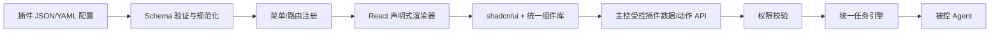

# ADR-PLUGIN-001 — 声明式插件页面与插件架构（已批准）

> 决策状态：**Accepted / 已批准**  
> 决策版本：v0.2（将 v0.1 的 D1～D4 和补充规则 D5～D8 一并批准）  
> 日期：2026-10-26  
> 适用项目：轻量级 AI 服务器群控平台  
> 对应总文档：[PRD v0.6](./01-PRD-需求文档-v0.6.md) · [架构 v0.6](./02-技术架构方案-v0.6.md) · [API v0.6](./03-API与通信协议-v0.6.md)

## 1. 背景与决定

用户希望主控保持轻量、插件页面与主控界面一致、多个 AI 编程 Agent 可独立开发功能插件；插件不应重造服务器连接、授权与任务执行系统。项目已采用 Go 模块化单体主控与独立 Linux Agent 的结构，前端方向明确选择 **React + TypeScript + Vite + shadcn/ui**。

本 ADR 确认：**插件 UI 仅使用声明式 JSON/YAML，主控内置统一渲染器；首版采用编译期内置插件后端，动态加载页面配置；后台操作统一复用主控核心 API 与授权。** 不采用 Next.js 运行时、微前端、任意插件自定义 React 代码或 iframe 前端作为首版能力。

本 ADR 冻结架构行为原则，而非具体字段命名、完整组件规格或后续插件运行时实现。

## 2. 八项批准决策

| ID | 已批准规则 | 约束与边界 |
|---|---|---|
| PLUGIN-D1 | 插件前端全部使用 JSON/YAML 声明式页面配置 | 插件不得向浏览器注入任意 React/JS/HTML；YAML 读取后规范化为 JSON 数据结构 |
| PLUGIN-D2 | 首版内置插件后端 + 动态页面配置，后续支持外部后端插件 | 首版业务处理代码随 Go 主控构建；动态读取 UI 配置**不等于**任意后端代码热加载；独立进程插件属于后续阶段 |
| PLUGIN-D3 | 首版约九类标准组件，按需扩展 | 保证通用表单、展示、任务交互场景，不首建拖拽可视化编辑器 |
| PLUGIN-D4 | 插件统一使用主控 API、权限与任务引擎 | 插件不得直接访问 Agent 连接、持有主控秘密、执行未经授权的 root 任务 |
| PLUGIN-D5 | 标准组件库可继续扩展 | 新增组件由主控统一提供，需定义组件协议和兼容范围 |
| PLUGIN-D6 | 插件页面与后端能力解耦 | UI Schema 引用已注册的数据源/动作 ID，不直接绑定插件语言实现或任意 HTTP URL |
| PLUGIN-D7 | 统一页面模板 + 轻量预览 | 模板优先覆盖表单、列表、仪表盘、详情；预览使用 Mock 数据，绝不执行真实远程任务 |
| PLUGIN-D8 | 插件沿用核心权限，并禁止注入任意前端脚本 | 每一次数据查询/操作由主控按用户权限与插件授权交集检查；禁用插件即时撤销入口、动作与 AI 工具 |

## 3. 产品体验

1. 管理员启用一个内置插件，例如“服务检查”。
2. 主控读取并验证插件清单、`uiVersion` 与页面 JSON/YAML；通过统一组件映射生成菜单和页面。
3. 用户从服务器选择器选中节点，填入参数并点击“检查”；前端仅发送插件内已登记的动作 ID 和用户输入。
4. 主控检查登录用户、节点作用域、插件允许的能力、root 操作所需的确认；通过既有任务引擎执行并写入现有审计。
5. 主控提供任务状态/日志，页面使用通用组件显示；禁用插件后菜单和已注册能力一起隐藏并被服务端拒绝。

最终部署仍是**单个 Go 主控可执行文件 + 内嵌已构建的 React 静态资源**（开发时前后端分离）；不强制 Node.js 服务器常驻。未使用的可选插件功能按需触发，不额外启动前端服务。

## 4. 标准页面规范（第一版）

### 4.1 首版组件类别（约九类）

1. 文本/数字等输入框（`input`）
2. 下拉选择（`select`）
3. 服务器与分组选择器（`server-selector`）
4. 复选框或开关（`checkbox`）
5. 数据表格（`table`）
6. 操作按钮（`action-button`）
7. 统计卡片与简易图表（`stat-chart`，重量级图表库按需加载）
8. 任务状态与日志（`task-log`）
9. 确认对话框（`confirmation`）

以 shadcn/ui 和统一设计 Tokens 为主，服务器选择器及任务日志是少量自建业务组件；组件是否需要拆分成更细类别可由实现测试调整，但不改变“由主控统一提供组件”的原则。

### 4.2 页面模板

`form`（表单操作）、`table`（列表操作）、`dashboard`（指标概览）、`detail`（详情）。插件选择其中一种模板、配置组件与布局槽位，不允许自定义 CSS/脚本越过主控布局；复杂 UI 在下一阶段新增主控标准组件，而非把任意页面代码加入插件包。

### 4.3 页面描述示例（草案）

```yaml
id: service-inspector
name: 服务检查
version: 0.1.0
apiVersion: v1
runtime: builtin
permissions:
  - nodes:read
  - jobs:submit
  - jobs:read
ui:
  uiVersion: 1
  menu:
    title: 服务检查
    icon: server
  pages:
    - id: main
      title: 服务检查
      template: form
      fields:
        - id: targets
          type: server-selector
          label: 服务器
          required: true
        - id: service
          type: input
          label: 服务名称
          required: true
      actions:
        - id: inspect
          type: action-button
          label: 开始检查
          actionRef: services.inspect
          inputMap:
            node_ids: targets
            name: service
      results:
        type: task-log
```

上例中的 `actionRef` 是已注册的**服务端动作**，不是任意可配置 Shell 命令；`inputMap` 只可映射当前表单中已定义的字段。正式协议结构仍以 API 文档及后续 OpenAPI/JSON Schema 为准。

## 5. 运行与安全边界

- **解析**：配置在服务器端严格校验（JSON Schema 或等价验证器），约定版本 `uiVersion`；不支持的字段/组件必须明确报错，不能执行未知动作。YAML/JSON 只能承载数据，不能包含函数、脚本或可执行模板表达式。
- **渲染**：React 渲染器仅映射主控允许列表内的组件，文本默认安全转义，不将未经审查的 HTML 交给浏览器解释。插件无法修改全局登录态或安全页面外壳。
- **读数据**：只能引用主控登记的数据源 ID；不能用页面配置构造任意外部 URL 或请求主控内网地址。
- **写操作**：只能通过插件标识及已登记 `action_id` 调用统一业务服务；后端独立校验用户身份、节点范围、动作权限和数据约束。按钮隐藏与前端校验不是授权。
- **特权边界**：完全遵守 ADR-PRIV-001：Web root 任务整批一次真实服务端确认，AI 任意 root Shell 必经授权人确认；任务仍走 mTLS 与 Agent 去重审计。
- **插件后端**：首版 `builtin` Go 插件属于与主控同进程的可信代码，不能声称它已被沙箱隔离；第三方任意二进制不在首版安装范围内。P2 外部插件必须再定义 OS 隔离、独立身份、资源限制及升级信任策略。
- **预览**：使用 Mock 数据与沙箱式前端状态，不执行 Agent 任务、不修改 DNS、证书或实际节点；如提供 API，必须为单独只读预览路径或本地开发模式。

## 6. 组件与数据流



**版本化约定**：插件 `apiVersion`（后端能力协议）与 `ui.uiVersion`（页面描述协议）独立。主控可同时支持有限数量的页面版本，但不得在不兼容时静默渲染；禁用插件清除菜单/路由缓存，客户端刷新后不得继续提交已失效动作。

## 7. 推荐接口边界（示意，不冻结路径）

- `GET /api/v1/plugins`：可见插件列表，仅显示启用且有访问权限的插件。
- `GET /api/v1/plugins/{id}/ui/pages/{page_id}`：获取已验证的、权限过滤后的页面描述。
- `GET /api/v1/plugins/{id}/data/{source_id}`：读取该插件已登记的数据源；参数受控且限权。
- `POST /api/v1/plugins/{id}/actions/{action_id}`：调用后端已登记动作，禁止任意 URL 或 Shell 注入路径。
- `POST /api/v1/plugins/{id}/enable|disable`：管理员变更内置插件启停；禁用后即时拒绝 API/AI 工具。

返回任务标识后，插件页面通过已有任务详情/事件 API 获取执行过程，不再另建任务系统。具体 HTTP 方法、路径与错误码在正式 OpenAPI 评审时冻结。

## 8. 验收标准（第一版）

- 内置示范插件只凭配置生成菜单与表单，无需单独写 React 页面或前端重新构建；启停后菜单与后端动作同步生效。
- 表单、列表、任务日志三个场景可完成渲染与 Mock/真实数据闭环；统一主题、响应式布局与深浅色模式一致。
- 无效 Schema、未知组件、未知 `actionRef`、不兼容 `uiVersion` 会被拒绝并提示，而非任意执行。
- 权限不足时服务端拒绝读/写；不能通过 DevTools 请求、修改 JSON 配置或 AI/插件上下文绕过 root 审批与节点范围。
- 预览只能使用 Mock 数据；关闭或禁用插件后，不能继续使用先前保留的操作 URL 完成任务。
- 主控构建产物不需要常驻 Node.js、独立前端服务、Kubernetes 或 Redis。

## 9. 非目标、风险与可演进项

**本阶段不做**：拖拽式低代码编辑器、第三方前端 JS/HTML/自定义 React 组件加载、微前端、iframe 插件页面、任意外部插件包安装、复杂前端可视化流程编排。若未来确需，必须新 ADR 讨论威胁模型与兼容范围。

**已接受的取舍**：声明式 UI 会限制高度个性化页面；通过给主控组件库增加可复用标准组件解决，而非让插件直接执行不受控的脚本。

**后续候选**：独立外部后端插件（独立进程 + 版本化 RPC）、插件市场、更多可复用业务组件、可选高级布局模式。均不视为本 ADR 已批准立即实施。

## 10. 修订与决策记录

| 日期 | 状态 | 内容 |
|---|---|---|
| 2026-10-26 | 提案 v0.1 | 原有 D1～D4 以及新增 D5～D8 供用户审核 |
| 2026-10-26 | **Accepted v0.2** | 用户批准 PLUGIN-D1～D8；明确声明式渲染、内置后端+动态页面、可扩展主控组件、预览与统一权限，选择 React + Vite + shadcn/ui |

## 11. 与既有 ADR 的兼容性

- ADR-WC-001：Cloudflare + ACME 仍是**主控内置可选能力**，不受本插件机制替代；证书私钥默认在节点本地。
- ADR-BOOT-001：插件页面不能参与替代 Agent 注册信任与 mTLS 验证。
- ADR-PRIV-001：单个 root Agent 与真实降权模式不变，插件不具备绕过审批的执行路径。
