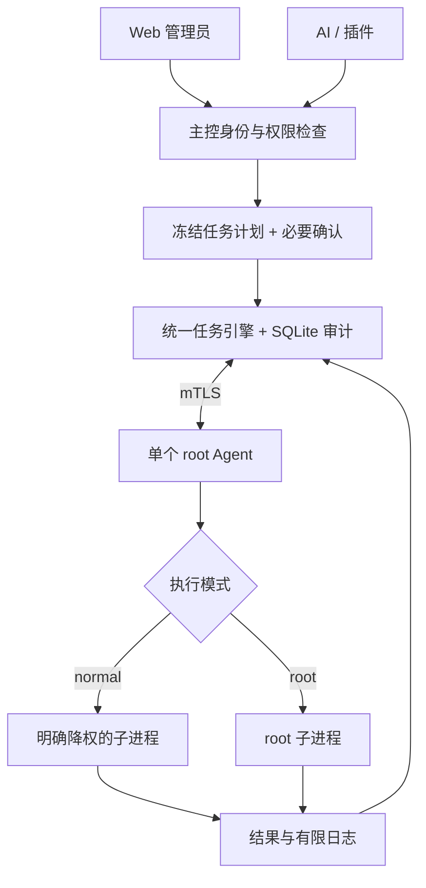

# ADR-PRIV-001：Agent 权限与远程执行安全模型

> 项目：轻量级 AI 服务器群控平台（Server Fleet）  
> 版本：v0.3（2026-10-26；2026-10-26 正式批准）  
> 状态：**Accepted / 已批准**  
> 基于：ADR-PRIV-001 v0.2 精简方案  
> 参考基线：项目总文档 v0.5；已批准 ADR-BOOT-001 与 ADR-WC-001  
> 本 ADR 已由项目所有者于 **2026-10-26** 批准，并同步成为项目总文档 **v0.5** 的约束；具体接口字段仍处于 v0.x 契约草案阶段。

## 1. 审核结论

**保留 v0.2 的单个 root Agent 架构，无需引入特权 Helper、独立签名任务票据、多级审批或企业级动态策略引擎。**

必须明确：`root Agent` 是可信计算基的一部分。若 Agent 进程被攻破或主控被攻击者取得 root 命令权限，攻击者可能完全控制被控 VPS；mTLS、任务审计和“普通权限子进程”不能消除此风险。这个代价符合以个人和小团队自有 VPS 为主的产品定位，但应在安装与文档中予以说明。

首版安全基线只增加四类**实现约束**，不新增常驻组件：
1. 普通任务确实降权，失败即拒绝，不得悄悄回退 root。
2. root 操作的授权和人工确认由主控服务端判定，AI 或插件无权自行批准。
3. 每节点任务执行 ID 在 Agent 本地进行**轻量持久去重**，断线重连不盲目重跑。
4. 凭据保护、日志限额与最小审计为核心能力，避免泄露或无界资源消耗。

## 2. 精简运行架构



- `fleet-agent`：一个 Go 二进制、一个 systemd 服务，默认以 root 启动。没有独立 sudo Helper，也不需要设置 `NOPASSWD: ALL`。
- 普通命令：显式使用独立低权限执行账户 UID/GID，清空不必要的附属组；指定有限环境变量、工作目录、超时及输出上限。降权失败就报错。须测试实际 UID/GID，不能只依靠 Web 字段。
- root 命令：直接以 root 子进程执行，无需调用 sudo；Web 可称为“sudo / root 模式”。该能力意味着完整节点管理权限，不承诺任意 root Shell 的可沙箱化。
- Agent 不监听公网入站命令端口，只向已验证的主控建立 mTLS 连接；仍验证节点身份、连接状态及下发任务的目标与版本。
- 不使用依赖命令内容的黑名单假装能阻止恶意 root 操作。Shell 命令会运行 Shell 语法；服务端应将提交的**完整命令原文**绑定到确认对象，不得在执行前默默改变。

## 3. 任务授权与确认：保留一次确认，不做多级审批

首版最小用户角色：`admin` 与 `viewer`。`viewer` 不能执行任何命令；`admin` 可创建任务和批准 root 操作。插件和内置 AI **继承发起用户的权限和目标范围**，不能使用超级管理员后门接口。

| 场景 | 行为 |
|---|---|
| 管理员普通权限任务 | 经服务端身份检查直接派发 |
| 管理员手工 root Shell | Web 显示目标与完整命令，整批**一次确认** |
| AI 生成 root Shell | 显示实际目标与命令；由已登录管理员点击确认后派发 |
| 插件标准运维动作 | 通过同一任务引擎；需要 root 时按统一 root 确认规则执行，后续可审议预授权模板 |
| 未授权用户 / 插件 / AI | 服务端拒绝，记录失败审计 |

**确认必须服务端生效**：
- 提交待批准任务时，服务端冻结 `node_ids` 快照、完整命令（或动作参数）、`privilege`、超时、并发和部署文件摘要，计算不可变 `plan_digest`。
- 批准接口检查当前登录用户的授权与确认动作，并确保被批准的对象仍然是相同的 `plan_digest`。任何重要参数变化均需重新批准。
- “同一个管理员创建并批准”被允许；这是一次确认，不是双人审批。
- AI 的工具目录不含能够批准自己的 `approve_job`。仅由真实用户交互路径触发批准；不信任模型输出中“已批准”等文本。服务器日志和文件内容一律视为不可信指令来源。
- 凭据型管理员账号失陷后攻击者仍可能提交和批准 root 任务；首版不声称一次确认能防止该风险。推荐主控 Web 使用安全会话配置、CSRF 防护、强认证，并预留可选二次验证。

## 4. 任务模型与执行安全

沿用 `POST /api/v1/jobs`、`POST /api/v1/jobs/{id}/approve`、`POST /api/v1/jobs/{id}/cancel`，不另建 root 专用 API。示例：

```json
{
  "action": "system.exec",
  "targets": {"node_ids": ["node_01", "node_02"]},
  "params": {"command": "apt-get update && apt-get install -y nginx"},
  "execution": {"privilege": "root"},
  "policy": {"timeout_seconds": 300, "concurrency": 2, "retry": 0}
}
```

- `execution.privilege` 只是请求，不是授权证据。
- 普通任务严格指定 UID/GID，并提供最小环境变量；特别不能把主控 URL 注册 Token、Agent mTLS 私钥或访问凭据通过环境变量传给命令子进程。Agent 的密钥文件应由 root 独占权限保护。
- root 任务具备读取本机 Agent 凭据的能力，这是方案固有风险；不能宣称 root 执行与 Agent 凭据完全隔离。
- 限制单节点并发数、命令超时、stdin、stdout/stderr 总量和本地缓存大小；尽力清理任务进程组。恶意进程可能脱离进程组，不能把超时等同于绝对资源隔离。
- 改动防火墙、路由或 SSH 配置的批量任务，Web 提供“先试一台、再执行剩余”的简易开关，但首版不实现复杂编排。

## 5. 防重复执行与离线恢复

- 主控每个节点生成唯一 `execution_id`。
- Agent 在**开始执行前**将该 ID、任务摘要和启动状态写入本地 root 私有的小型持久化执行记录；完成后记录终态。实现可以使用原子写入的小型日志文件，或经实际测试选择嵌入式存储；不新增常驻数据库服务。
- 收到重复 `execution_id` 时不重复启动命令，而是返回已有状态或已缓存结果。
- Agent 崩溃且任务结果不确定时，标为 `unknown`；对 root Shell、非幂等命令默认**不自动重试**，由管理员核实后新建任务。
- 重连只恢复通信和状态同步，不代表恢复执行任何旧命令。设置任务过期时间，拒绝超过时限的未执行任务。
- 文件记录有数量及保留期限上限。裁剪之前应确保不会与主控可能重新派发的旧任务时间窗冲突。

## 6. 最小审计与凭据保护

主控复用 `jobs`、`job_executions`、`audit_logs`（SQLite），至少保存：操作者、来源（web / AI / plugin）、批准人、不可变目标快照、命令或动作摘要/受控内容、执行权限、任务时间、结果、退出码和错误原因。

- 原始命令和 stdout/stderr 可包含密钥等敏感内容；为读取和保留设置权限、掩码规则、字节上限与保留期限。不要将注册 Token、mTLS 私钥或 Cloudflare API Token 写入普通日志。
- 审计是便于追踪的记录，不保证主控或节点已被 root 攻破时仍不可篡改。不可篡改集中审计可作为后续增强。
- Agent 安装文件、systemd 服务单元、密钥目录必须由 root 拥有，并按 ADR-BOOT-001 验证 Agent 更新包的可信来源与签名。

## 7. Linux / systemd 兼容性注意事项

- `NoNewPrivileges=yes` 限制之后经 `execve` 获取新权限，但在单个**已经以 root 启动**的 Agent 中，并不能据此断言任务不再有 root 权限；它也可能影响某些合法 sudo/setuid 工作流。任何 systemd 沙箱选项都要在 root 运维、Docker 和普通降权任务上做兼容性测试。
- 不要默认启用会阻止系统管理任务所需文件或内核操作的强限制后再宣称支持任意 root Shell；选择 root Agent 就必须诚实接受该架构的特权边界。
- Agent 的 Go 进程自身保持简洁，尽量不链接非必要的第三方执行框架；复杂度主要集中在现有任务引擎而不是新增进程。

## 8. 安全验收（首版最小集合）

- [ ] 通过一条安装命令完成 Agent 部署，普通与 root 任务均可执行，不需 sudo 密码。
- [ ] 普通任务真实 UID/GID 非 root；降权失败必须拒绝执行。
- [ ] viewer、无权插件或 AI 不能通过修改请求字段获取 root 执行权。
- [ ] AI 发起的 root Shell 在管理员交互确认前不能派发。
- [ ] 批量 root 任务确认锁定具体目标和命令，更改后确认失效。
- [ ] 重复 `execution_id` 不重复执行，Agent 重启后仍能去重；结果不明的任务不自动重跑。
- [ ] Agent 被禁用后不接新任务；断线后拒绝过期任务。
- [ ] 命令输出、任务时长、并发数均有界，私钥文件与审计权限正确。
- [ ] 真实 1 核 1GB VPS 场景通过性能测试。

## 9. 明确推迟

不在第一版实现：独立 sudo Helper、签名任务票据、节点端额外权限策略引擎、多级审批、完整命令沙箱、复杂 RBAC、审计专用服务。仅当产品目标扩大到陌生用户共享主机或多租户托管环境，再重新评估其必要性。

## 10. 已批准决策（PRIV-D1～D8）

| 编号 | 推荐决策 |
|---|---|
| PRIV-D1 | 单个 Go Agent 二进制，默认 root 常驻，不单独配置 sudo Helper |
| PRIV-D2 | Web 提供普通 / root 两种执行模式，普通模式真实降权 |
| PRIV-D3 | root 子进程直接执行，无需交互式 sudo 密码 |
| PRIV-D4 | 管理员人工 root 任务按冻结目标和命令整批确认一次 |
| PRIV-D5 | AI 任意 root Shell 必须经授权管理员人工批准 |
| PRIV-D6 | 主控 SQLite 最小审计，日志访问和保留受控 |
| PRIV-D7 | mTLS、服务端鉴权、任务超时与本地持久去重不可省略 |
| PRIV-D8 | 特权 Helper、签名票据、多级审批推迟到未来 |

## 11. 版本历史

| 版本 | 日期 | 状态 | 内容 |
|---|---|---|---|
| v0.1 | 2026-10-26 | 已替代草案 | 低权限 Agent + sudo Helper + 签名票据与多级审批 |
| v0.2 | 2026-10-26 | 已由本稿细化 | 精简为单个 root Agent，两种权限模式与统一审计 |
| v0.3 | 2026-10-26 | **已批准（Accepted）** | 进一步明确服务端确认、子进程降权、持久去重、密钥与日志边界；未增加常驻组件；由项目所有者批准后纳入总文档 v0.5 |

## 12. 参考

- systemd.exec：NoNewPrivileges 和服务安全限制：https://www.freedesktop.org/software/systemd/man/latest/systemd.exec.html
- OWASP AI Agent Security Cheat Sheet：https://cheatsheetseries.owasp.org/cheatsheets/AI_Agent_Security_Cheat_Sheet.html

## 13. 决议与适用范围

项目所有者已批准 PRIV-D1～D8 及本文第 1～9 节四项不可省略的安全实现约束。该决议取代 v0.1 的 Helper/签名票据/多级审批方案和 v0.2 待审核状态；不更改 ADR-WC-001、ADR-BOOT-001 的已批准内容。若后续将产品转为多人共享或不可信租户环境，须重新审查 root Agent 的安全风险。

**关联文档：** [PRD v0.5](./01-PRD-需求文档-v0.5.md) · [架构方案 v0.5](./02-技术架构方案-v0.5.md) · [API v0.5](./03-API与通信协议-v0.5.md)。
