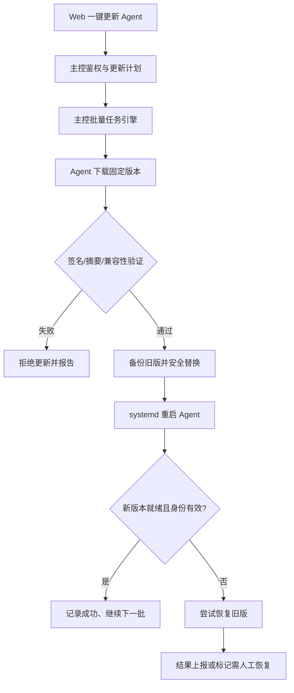

# ADR-UPDATE-001：Agent 自动更新与版本管理（已批准）

- **版本**：v1.0（正式批准；基于 v0.1 审核草案）
- **状态**：**Accepted / 已批准；UPDATE-D1～D8 全部通过**
- **日期**：2026-10-26
- **适用范围**：Server Fleet，轻量 Go 主控 + 单个 root Agent（systemd）
- **关联已批准决策**：ADR-BOOT-001、ADR-PRIV-001、ADR-TASK-001、ADR-AI-001
- **项目总文档**：Server Fleet v0.9（已同步；v0.8 原文件保持不变）

## 1. 一句话摘要

管理员在 Web 面板看到可更新的 Agent 版本，选择节点后一键确认；系统**先测试 1 台，再每批最多 5 台**，每台下载经过可信签名验证的安装包，更新失败时尽可能恢复上一版本。无需逐台 SSH，也不增加永久驻留的更新守护进程。

**本 ADR 的“自动更新”是“一键批量自动完成更新过程”，不等于默认后台静默升级。** 首版默认只提醒新版本、由有权限的管理员手动发起升级；以后根据需要引入定时自动更新。

## 2. 用户体验与产品范围

用户在“服务器 → Agent 版本”看到：主控版本、各节点 Agent 版本、兼容性状态、更新可用标识；可按地区、服务分组和版本筛选节点，点击“更新选中节点”，一次性查看目标与版本后确认。升级中显示待下载、校验、准备替换、重启、健康检查、成功、回退中、回退成功、需要人工处理等状态。

- **MVP 包含**：版本发现、固定目标版本、下载校验、分批更新、完整身份保留、基础健康检查、回退尝试、结果可见、审计。
- **MVP 不含**：后台强制自动更新、从不可信 URL 执行安装包、对所有 Linux 发行版做复杂包管理、无人值守系统升级或内核更新、完整 TUF 平台、独立升级微服务、插件市场的自动升级。
- **更新的是群控 Agent 本身**，不是 VPS 上的 Ubuntu/Debian 软件包；后者继续走任务系统。

## 3. 已批准约束（不得被更新流程破坏）

1. **ADR-BOOT-001**：安装器和 Agent 发行物采用固定版本、可信摘要及数字签名校验；Agent 仍信任原私有 CA，Root CA 公钥指纹固定不可在升级时无条件替换。
2. **ADR-PRIV-001**：仍然只有一个常驻的 root Agent；普通命令需要真实降权。更新过程可以按需调用**当前 Agent 二进制的短暂 update 子命令 / systemd 一次性任务**，这不是第二个长期运行的 Agent、特权执行服务或新的网络入口。
3. **ADR-TASK-001**：复用同一个任务管理与批次执行入口；对更新引发的短暂断连，必须有独立的升级状态机，不可把“连接断开”自动认定为失败或成功。批次失败暂停新批次；离线任务仍受 TTL 控制。
4. **ADR-AI-001**：AI 可查询版本、建议更新和准备计划，但不得绕过主控操作权限与管理员确认；不得直接决定或上传未授权升级包。
5. **Agent 节点身份、mTLS 私钥、注册凭据与配置**必须保存在与版本化二进制不同的受保护目录；程序升级不是节点重装或身份替换，不能让它自动创建新 Node ID。

## 4. 简明系统方案

每次更新是一个批量任务，每个节点有独立的升级执行 ID、状态和版本记录。更新时不要求用户再次手动登录 SSH，也不新增 Redis、Kafka 或常驻升级守护进程。

## 5. 已批准决策（UPDATE-D1～D8）

| 编号 | 推荐决策 | 解释 |
|---|---|---|
| **UPDATE-D1** | **手动发起、自动完成**；面板提示可更新版本，首版不默认静默升级 | 最符合轻量与可控；避免用户不知情重启 Agent |
| **UPDATE-D2** | 主控与 Agent **独立版本**，握手时声明支持的协议/功能；升级前检查兼容性 | 主控更新不等于立刻强迫所有 Agent 更新 |
| **UPDATE-D3** | 固定目标版本 + **可信数字签名及 SHA-256 校验**；Agent 内置/固定发行验签公钥 | HTTPS 只保证传输，必须确认包确实由受信任发布者发布 |
| **UPDATE-D4** | 默认**先测试 1 台，再每批最多 5 台**；发现问题暂停后续批次 | 与已有批量任务策略一致；允许管理员配置并发但高风险升级保留试运行 |
| **UPDATE-D5** | 新版本无法启动或健康检查失败时**自动尝试回退**；失败明确提示人工处理 | “尽可能恢复”而非保证任何情况下 100% 回退 |
| **UPDATE-D6** | 保留上一版可执行文件；节点身份、CA 信任链、私钥、配置与二进制分离 | 升级及回退都不能重新注册或丢失身份 |
| **UPDATE-D7** | 首版只采用**稳定版更新通道**；测试版和自定义发行包留待后续按需支持 | 减少兼容性与版本管理复杂度 |
| **UPDATE-D8** | Web、AI、插件均使用统一的更新任务入口；由有权限管理员确认，记录审计与结果 | 禁止 AI 自行批准或绕过验签，也不另写一套审批系统 |

## 6. 更新安全边界

- **发行包来源**：固定发布版本、平台/架构（如 Linux amd64 / arm64）、大小、摘要和签名；可信验签公钥随已验证安装器安装，不能从同一未信任响应临时下载新公钥后直接接受。
- **密钥职责分离**：Agent 发行版**签名私钥**保管在受控发布环境中，不应保存于公网主控；不得拿私有 mTLS Root CA 私钥签名 Agent 发布包。自建发行渠道需支持管理员显式信任自己控制的发布公钥。
- **反降级**：默认拒绝未授权的历史版本降级；人工选择“回退到上一已验证版本”属于明确授权的恢复流程。记录最高已确认版本与可信发行信息；避免旧包伪装成最新升级。将来有复杂发布渠道时再考虑完整 TUF 元数据机制。
- **预检查**：核实系统/架构、协议兼容、目标版本高于当前版本、可用磁盘、当前任务状态、签名有效、下载量与超时设置；有关键任务运行中时默认暂缓，而不是强制杀死任务。
- **更新期间**：先下载到临时目录并验证，再保存上一版与准备好的新版本；切换和服务重启使用受控 systemd 操作。并行更新不得同时改变节点 CA 信任锚。
- **Web/AI 授权**：非管理员不能发起全局 Agent 更新；AI 可以推荐但不能绕过确认、批准新验签公钥或签发新 Agent 身份。
- **审计**：记录谁发起、何时、目标 Node ID 快照、原/目标版本与发行摘要、进度、回退原因和最终结果；不记录 mTLS 私钥、API Key。

签名与摘要解决发布包真实性及完整性问题，但**不自动解决所有旧版重放、签名密钥泄露或被攻破的构建链路风险**；这也是未来可以参考 TUF 机制但首版不需要重造整套系统的理由。

## 7. 回退机制与局限

建议**同一个 Agent 程序同时提供服务模式和短暂的更新执行模式**。更新时先备份旧版本、验证新版本，再由受控一次性 systemd 操作切换二进制与启动；如果启动超时、启动崩溃或本地健康检查不通过，可使用保存的旧二进制恢复服务。短暂更新进程不常驻，也不需要开放端口。

- 回退成功的判断，应同时考虑新/旧 Agent 进程就绪和是否恢复合法的主控 mTLS 连接；但**“无法连主控”也可能是网络问题，不应无限回退或反复重启**。网络不可达时先检查本地健康，状态可能保持“待确认”。
- 最多保留一个已验证上一版以降低磁盘开销；允许设置过期清理策略。
- 更新包错误、启动崩溃、配置不兼容：尝试自动回退。
- 磁盘故障、系统断电、systemd 不可用、旧配置不可逆变化或二进制/密钥均损坏：**不能保证自动回退**，需要管理员通过 SSH/控制台修复。
- 版本迁移涉及状态数据时必须保持向后兼容或提供可验证的恢复策略；首版尽量不做破坏性数据迁移。

## 8. 和现有任务系统的关系

- 一次升级操作在 `jobs` 中保存一个父任务，目标 Node ID **固定快照**；每台 Agent 升级记录独立阶段与结果。
- 第一台更新成功且通过健康检查后，才允许第二批最多五台开始；后续某节点更新失败，完成当前批次后**暂停后续批次**，管理员可检查后继续。
- 离线目标不会无限期排队；默认复用已批准的 15 分钟任务 TTL。过期未执行则需要重新确认任务，不静默在数天后升级。
- 更新期间与 mTLS 连接暂时断开是预期现象；主控不应立即重复发布更新任务。相同节点 + 更新执行 ID 必须幂等核对，不再次启动同一安装操作。
- “取消”在下载前或切换前可以停止；**已经进入原子切换/重启阶段后只能等待本次切换或回退完成**，不可强行清理旧版并中断恢复。

## 9. 首版页面设计

“服务器 → Agent 版本与更新”列表列出：节点、当前版本、建议版本、兼容性、更新时间、状态和操作。支持地区/服务分组筛选、“检查更新”、“更新选中节点”、“查看日志”。

点击升级前，弹出一次确认：目标节点数、版本号、发行来源、更新次序、可能的短暂离线影响和失败暂停策略。升级进度可查看每台节点；有失败时显示“重试/人工恢复”建议，不允许对不确定副作用无条件重试。

## 10. 接口/数据模型草案（实现字段尚未冻结）

- `GET /api/v1/agents/releases`：查询可信发行版本、渠道、签名和兼容范围（只返回公开元数据）。
- `GET /api/v1/nodes/agent-versions`：查询在线与离线节点的软件版本及兼容信息。
- `POST /api/v1/agent-updates/plans`：创建版本与 Node ID 固定快照计划，做预检查并返回 `plan_digest`。
- `POST /api/v1/agent-updates/plans/{id}/confirm`：有权限的管理员确认计划，创建关联 `job_id`，复用任务审计。
- `GET /api/v1/agent-updates/{id}`：读取总体状态和逐节点阶段。
- Agent 消息：`UpdateOffer`、`UpdateProgress`、`UpdateResult`、`UpdateReconcile`（按已有版本化 Protobuf 扩展）；更新阶段需明确 `execution_id` 和摘要。

**注意**：接口路径和消息字段仍为实现草案，正式 API 应使用现有 `/api/v1/jobs/{id}/approve` 的授权语义，不可建立第二套相互独立的审批服务。更新核心状态建议为 `pending`、`precheck`、`downloading`、`verified`、`switching`、`restarting`、`health_check`、`succeeded`、`rolling_back`、`rolled_back`、`needs_manual_repair`、`unknown`、`cancelled_before_switch`。

## 11. 验收场景

1. 选择 20 台节点，一次确认后按 **1 → 5 → 5 → ...** 流程更新，每台可单独查看进度和版本。
2. 篡改安装包或签名，Agent 必须拒绝执行；架构不匹配也必须拒绝。
3. 第一台更新失败，则其余节点没有开始更新；5 台批次中任意节点失败，后续批次暂停。
4. 新版因崩溃无法启动时，尝试恢复上一已验证版本；故意破坏磁盘/服务导致无法恢复时，界面必须报告需人工修复，不能虚报“成功”。
5. 更新后 Node ID、原 CA 信任、mTLS 身份凭据、服务分组和任务历史未改变。
6. 主控更新 Agent 版本、Agent 升级主控版本均能正确做版本/协议兼容协商，不兼容时拒绝危险操作。
7. 离线节点 15 分钟任务过期后重新上线，不会意外执行旧升级命令。
8. 没有管理员确认，AI 不能自行发起升级；普通用户不能跳过授权；更新/回退都保留可追溯记录。
9. 在 1 核 1 GB VPS 环境下记录升级期间最大 RSS、磁盘临时空间、下载流量和恢复耗时；指标不由文档预先虚构。
10. 中途断网/主控重启/Agent 更新重启，不应无限重复切换、写坏身份私钥或导致无界重试。

## 12. 批准记录与实施边界

**项目发起人于 2026-10-26 明确批准 UPDATE-D1～D8 全部推荐决策，正式状态 Accepted。** 本 ADR 已纳入 Server Fleet v0.9 的 PRD、架构方案、API 契约草案与 README；所有 v0.1～v0.8 快照保持不变。

批准的是**产品行为与安全边界**，不等于升级器代码已实现、回退保证 100% 成功、签名封装格式已冻结或真实 VPS 压测已经通过。首版需先完成一次性 systemd 更新/回退路径验证、签名与摘要篡改拒绝测试、版本协商与 1 核 1 GB 实测。

**决策生效说明**：UPDATE-D1～D8 不推翻 BOOT 的发行签名、PRIV 的单 root Agent、TASK 的批次/离线 TTL/幂等、AI 的管理员确认和 PLUGIN 的受控工具接口；任何变更这些核心约束的方案须另开 ADR 审核。

## 13. 参考依据

- The Update Framework（软件更新安全、签名/回滚/过时元数据威胁）：https://theupdateframework.io/docs/security/
- TUF 版本化签名元数据：https://theupdateframework.io/docs/metadata/
- systemd.service（服务重启与失败处理）：https://www.freedesktop.org/software/systemd/man/latest/systemd.service.html
